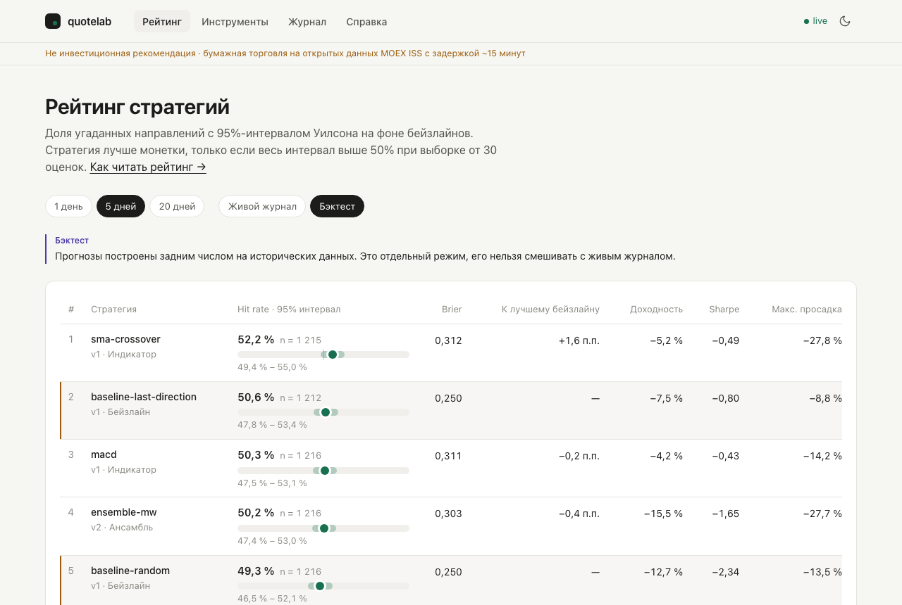
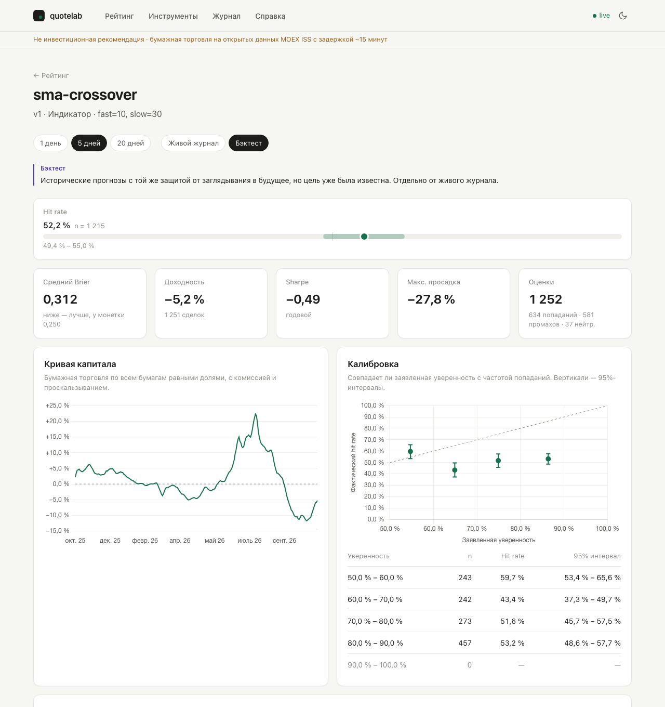
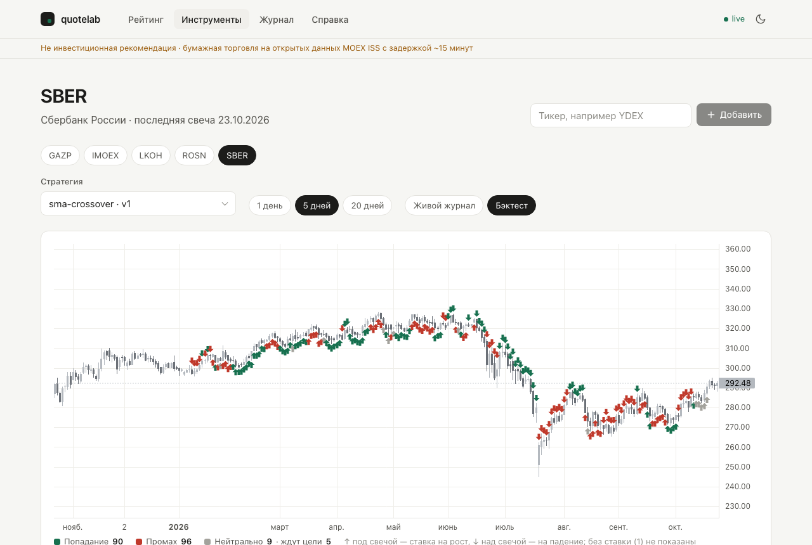
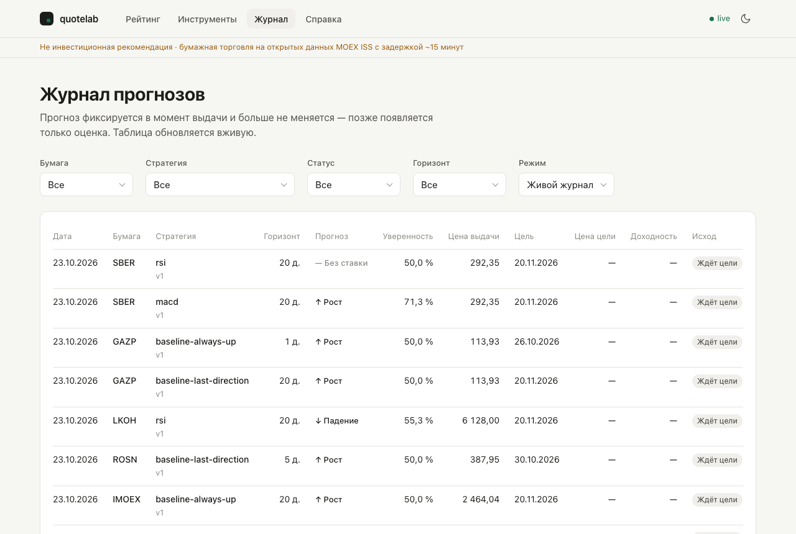
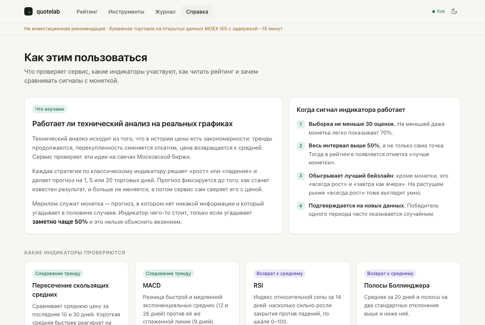
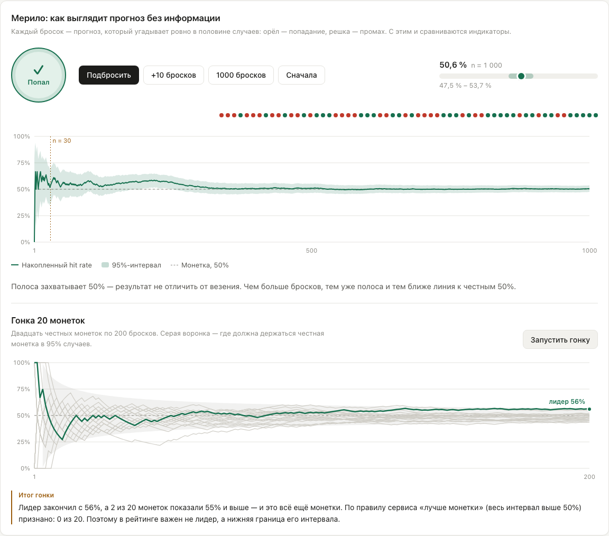
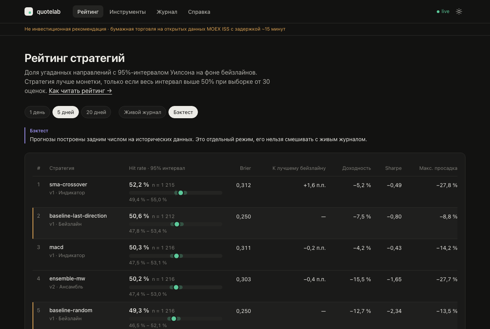

# quotelab — руководство пользователя

quotelab — лаборатория технического анализа на данных Московской биржи. Сервис проверяет, можно ли по прошлым свечам и индикаторам предсказать, куда пойдёт цена. Прогнозы стратегий фиксируются до того, как станет известен результат, потом сервис сам их проверяет и показывает честный рейтинг на фоне простых правил.

> **Не инвестиционная рекомендация.** Сервис не советует, что покупать, и не совершает сделок. Вся торговля бумажная, данные — открытые данные MOEX ISS с задержкой около 15 минут.

## Содержание

1. [Что изучает сервис](#что-изучает-сервис)
   - [Какие индикаторы проверяются](#какие-индикаторы-проверяются)
   - [Монетка как мерило](#монетка-как-мерило)
2. [Запуск](#запуск)
3. [Интерфейс](#интерфейс)
   - [Рейтинг стратегий](#рейтинг-стратегий)
   - [Страница стратегии](#страница-стратегии)
   - [Инструмент: свечи и прогнозы](#инструмент-свечи-и-прогнозы)
   - [Журнал прогнозов](#журнал-прогнозов)
   - [Справка и симулятор монетки](#справка-и-симулятор-монетки)
   - [Тёмная тема](#тёмная-тема)
4. [Как читать цифры](#как-читать-цифры)
5. [Живой журнал и бэктест](#живой-журнал-и-бэктест)
6. [Частые ловушки](#частые-ловушки)
7. [Вопросы и ответы](#вопросы-и-ответы)

## Что изучает сервис

Технический анализ исходит из того, что в истории цены есть закономерности: тренды продолжаются, перекупленность сменяется откатом, цена возвращается к средней. quotelab проверяет эти идеи на реальных графиках MOEX.

Каждая стратегия берёт классический индикатор, по свечам до сегодняшнего дня решает «рост» или «падение» и делает прогноз на 1, 5 или 20 торговых дней. Прогноз фиксируется сразу и больше не меняется. Когда горизонт наступает, сервис сверяет прогноз с фактической ценой. Так копится честная история результатов каждого индикатора на каждой бумаге.

### Какие индикаторы проверяются

| Стратегия | Индикатор | Логика сигнала | Подход |
|---|---|---|---|
| `sma-crossover` | Простые скользящие средние за 10 и 30 дней | Короткая средняя выше длинной — ставка на рост, ниже — на падение | Следование тренду |
| `macd` | MACD (12, 26, 9) — разница двух экспоненциальных средних против сигнальной линии | Гистограмма выше нуля — рост, ниже — падение | Следование тренду |
| `rsi` | Индекс относительной силы за 14 дней | Ниже 30 (перепроданность) — ставка на отскок вверх, выше 70 (перекупленность) — на откат вниз, между ними — без ставки | Возврат к среднему |
| `bollinger` | Полосы Боллинджера: средняя за 20 дней ± 2 стандартных отклонения | Закрытие ниже нижней полосы — ставка на возврат вверх, выше верхней — вниз, внутри — без ставки | Возврат к среднему |
| `ensemble-mw` | Ансамбль индикаторов выше | Объединяет их сигналы с весами; вес растёт у тех, кто чаще угадывал | Комбинация |

Чем сильнее сигнал (например, чем дальше короткая средняя от длинной), тем выше заявленная уверенность прогноза. Параметры каждой стратегии видны на её странице.

### Монетка как мерило

Чтобы понять, несёт ли сигнал индикатора информацию, нужна точка отсчёта. Прогноз, в котором информации нет совсем, угадывает направление в половине случаев — это и есть монетка. Удобная абстракция: индикатор полезен, только если угадывает **заметно чаще 50%** и это нельзя объяснить везением.

Сигнал индикатора можно считать работающим, когда выполнены все четыре условия:

1. **Оценок не меньше 30.** На меньшей выборке даже монетка легко показывает 70%.
2. **Весь 95%-интервал выше 50%,** а не только сама точка. Тогда в рейтинге появляется отметка «лучше монетки».
3. **Стратегия обыгрывает лучший бейзлайн.** Кроме монетки, сравнение идёт с правилами «всегда рост» и «завтра как вчера»: на растущем рынке «всегда рост» тоже выглядит умно.
4. **Результат подтверждается на новых данных.** Победитель одного периода часто оказывается случайным.

## Запуск

Нужен только Docker. Из корня репозитория:

```bash
docker compose up -d --build
```

Docker сам соберёт backend и фронт из исходников и поднимет PostgreSQL, backend и фронт. Первая сборка займёт несколько минут — скачиваются зависимости; повторные идут из кеша. После изменений в коде запустите ту же команду ещё раз.

| Что | Адрес |
|---|---|
| Интерфейс | http://localhost:4200 |
| REST API | http://localhost:8080/api |
| Метрики | http://localhost:8085/metrics |

При первом запуске сервис сам загрузит свечи за 2 года по стартовому списку бумаг (SBER, GAZP, LKOH, ROSN, IMOEX) и выдаст первые живые прогнозы. Живой журнал наполняется оценками по мере наступления горизонтов. Чтобы сразу увидеть рейтинг на истории, запустите бэктест за год:

```bash
curl -X POST "localhost:8080/api/admin/backtest?from=2025-10-20"
```

Он считается около минуты, результат — в режиме «Бэктест».

## Интерфейс

В шапке четыре раздела: **Рейтинг**, **Инструменты**, **Журнал**, **Справка**. Справа индикатор `live` — подключено живое обновление, таблицы и графики обновляются сами при новых прогнозах и оценках. Рядом переключатель светлой и тёмной темы.

### Рейтинг стратегий



Главная страница. Все стратегии на выбранном горизонте, отсортированные по нижней границе интервала: сверху те, в ком больше всего уверенности.

- **Горизонт** — 1, 5 или 20 торговых дней: на сколько вперёд сделан прогноз.
- **Режим** — живой журнал или бэктест (подробнее [ниже](#живой-журнал-и-бэктест)).
- **Строки с жёлтой меткой слева** — бейзлайны, точки отсчёта. Всё, что ниже лучшего из них, можно не рассматривать.
- **Hit rate · 95% интервал.** Крупно — доля попаданий, рядом размер выборки n. Полоса показывает интервал на шкале 30–70%, вертикальная черта — 50%. Пока n < 30, значения приглушены и стоит пометка «Мало данных».
- **К лучшему бейзлайну** — на сколько процентных пунктов стратегия угадывает чаще (или реже) лучшего из бейзлайнов.
- **Доходность, Sharpe, Макс. просадка** — результат [бумажной торговли](#как-читать-цифры) по сигналам.

Под таблицей предупреждения о множественных сравнениях и параметры бумажной торговли. На скриншоте год бэктеста: лидер `sma-crossover` угадывает 52,2%, но его интервал 49,4–55,0% захватывает 50%. Отличить его от монетки нельзя.

### Страница стратегии



Открывается кликом по имени стратегии в рейтинге. Сверху версия, тип и параметры — например, `v1 · Индикатор · fast=10, slow=30`.

- **Hit rate** — та же полоса, что в рейтинге, крупнее.
- **Плитки:** средний Brier (у монетки 0,250, ниже — лучше), доходность, Sharpe, максимальная просадка и число оценок с разбивкой на попадания, промахи и нейтральные.
- **Кривая капитала** — как менялся бы капитал при торговле по сигналам с учётом комиссии и проскальзывания. Пунктир — стартовый капитал.
- **Калибровка** — совпадает ли заявленная уверенность с частотой попаданий. Точки на диагонали — честная уверенность, ниже диагонали — стратегия переоценивает себя. На скриншоте при уверенности 80–90% фактический hit rate около 53%: стратегия сильно самоуверенна.
- **Последние прогнозы** — таблица со ссылкой на полный журнал по стратегии.

### Инструмент: свечи и прогнозы



Свечной график бумаги за год с прогнозами выбранной стратегии.

- **Бумаги** переключаются «чипсами» над графиком.
- **Стратегия, горизонт и режим** выбираются над графиком.
- **Маркеры:** ↑ под свечой — ставка на рост, ↓ над свечой — на падение. Зелёный — попадание, красный — промах, серый — нейтрально или ещё ждёт цели. Прогнозы «без ставки» не рисуются, их число указано в легенде.
- **Добавить бумагу:** введите тикер (например, `YDEX`) и нажмите «Добавить». Сервис проверит его на MOEX, загрузит историю и начнёт выдавать по нему прогнозы.

### Журнал прогнозов



Все прогнозы с фильтрами по бумаге, стратегии, статусу, горизонту и режиму. По каждому прогнозу видно:

- дату выдачи, направление и уверенность;
- цену на момент выдачи и дату цели;
- после оценки — цену цели, фактическую доходность, исход и Brier.

Прогноз фиксируется в момент выдачи и больше не меняется, позже к нему добавляется только оценка. Таблица постраничная, новые прогнозы появляются без перезагрузки.

### Справка и симулятор монетки



Раздел «Справка» коротко объясняет то же, что этот документ, и даёт потрогать идею руками.



**Симулятор** показывает мерило в действии — прогноз без информации: орёл — попадание, решка — промах.

- **«Подбросить», «+10 бросков», «1000 бросков».** График показывает накопленный hit rate и полосу 95%-интервала. На первых бросках линия скачет от 0 до 100%, полоса широкая; с ростом n полоса сужается и стягивается к 50%. Пунктирная вертикаль — порог n = 30. При наведении видно значение в любой точке.
- **«Гонка 20 монеток».** Двадцать честных монеток по 200 бросков, лидер подсвечен, серая воронка — где держится честная монетка в 95% случаев. Обычно лидер заканчивает на 56–60% и выглядит «гениально», хотя мастерства у него нет. Иногда лидер даже формально проходит правило «весь интервал выше 50%»: это ложный победитель. Ровно так же случайные стратегии иногда выглядят победителями в настоящем рейтинге.

### Тёмная тема



Переключатель солнце/луна в шапке. Выбор запоминается; при первом заходе берётся системная тема.

## Как читать цифры

| Показатель | Что это | На что смотреть |
|---|---|---|
| **Hit rate** | Доля прогнозов, где угадано направление | Сам по себе ничего не доказывает — смотрите на интервал |
| **95%-интервал Уилсона** | Где с высокой вероятностью лежит настоящая точность | Захватывает 50% — от монетки не отличить |
| **n** | Сколько прогнозов оценено с исходом «попадание» или «промах» | Меньше 30 — выводы делать рано |
| **Brier** | Штраф за самоуверенность: (уверенность − исход)² | Монетка — 0,250. Ниже — уверенность чего-то стоит, выше — стратегия обещает больше, чем умеет |
| **К лучшему бейзлайну** | Разница hit rate с лучшим из простых правил, п.п. | Отрицательная — стратегия хуже тривиального правила |
| **Калибровка** | Совпадение заявленной уверенности с частотой попаданий | Точки ниже диагонали — стратегия переоценивает себя |
| **Доходность** | Итог бумажной торговли за период | С учётом комиссии и проскальзывания по 0,05% за сторону |
| **Sharpe** | Доходность на единицу риска, в годовом выражении | Отрицательный — торговля по сигналам теряла деньги |
| **Макс. просадка** | Худшее падение капитала от пика | Насколько больно было бы следовать стратегии |

**Исходы прогноза.** «Попадание» — направление угадано. «Промах» — нет. «Нейтрально» — цена сдвинулась меньше чем на 0,1% или стратегия не делала ставку («без ставки»). Нейтральные прогнозы не входят в hit rate и Brier.

**Бейзлайны** — три тривиальные стратегии: `baseline-always-up` (всегда рост), `baseline-last-direction` («завтра как вчера») и `baseline-random` (честная монетка с фиксированным зерном).

**Бумажная торговля.** Ставка на рост — покупка, на падение — продажа, без ставки — деньги не участвуют. Каждый прогноз использует 1/h капитала, где h — горизонт, поэтому перекрывающиеся прогнозы не удваивают риск.

## Живой журнал и бэктест

**Живой журнал** — прогнозы, выданные в реальном времени и проверенные позже. Это единственный по-настоящему честный результат, но он копится медленно: нужно дождаться горизонта.

**Бэктест** — те же стратегии, прогнанные по истории. Стратегия по-прежнему видит только прошлое, но результат уже был известен миру. Режим удобен для быстрой оценки, но доверять ему стоит меньше. Поэтому он показывается отдельно, с фиолетовой пометкой «Бэктест», и никогда не смешивается с живым журналом.

## Частые ловушки

- **Множественные сравнения.** Чем больше стратегий сравнивается, тем вероятнее, что какая-то обгонит монетку случайно. Гонка монеток в «Справке» показывает это за три секунды.
- **Короткая история.** Несколько удачных недель ничего не значат.
- **Растущий рынок.** Если всё росло, ставки на рост выглядят гениально. Сравнивайте с `baseline-always-up`.
- **Высокий hit rate — не прибыль.** Можно часто угадывать мелкие движения и терять на редких крупных. Смотрите на кривую капитала и просадку.

## Вопросы и ответы

**Почему в живом журнале пусто или везде «мало данных»?**
Оценка появляется только когда наступает горизонт: для 1 дня — на следующий торговый день, для 20 дней — через месяц. Пока можно смотреть режим «Бэктест».

**Почему за какой-то день нет прогнозов?**
Живые прогнозы выдаются по будням в 19:15 по Москве, если сервис в это время запущен. Задним числом живые прогнозы не выдаются — иначе журнал перестал бы быть честным. Оценки за пропущенное время досчитываются при следующем запуске.

**Сохраняются ли данные между запусками?**
Да. Всё хранится в PostgreSQL на Docker-томе и переживает перезапуски. Данные удаляет только `docker compose down -v` (с флагом `-v`).

**Можно ли изменить или удалить прогноз?**
Нет. Это главный принцип сервиса: база данных запрещает менять прогноз после выдачи, кроме перевода в статус «оценён».

**Что значит версия стратегии (v1, v2)?**
Смена параметров стратегии даёт новую версию. Старая версия и её прогнозы остаются в базе и в рейтинге, поэтому результаты разных версий не смешиваются.
